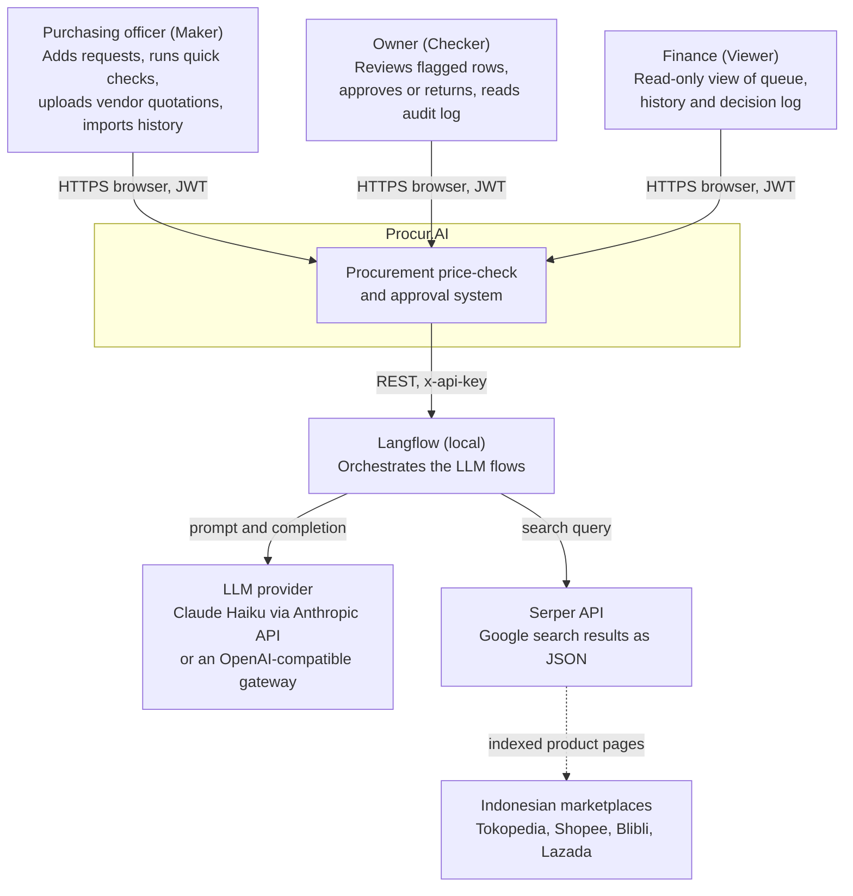
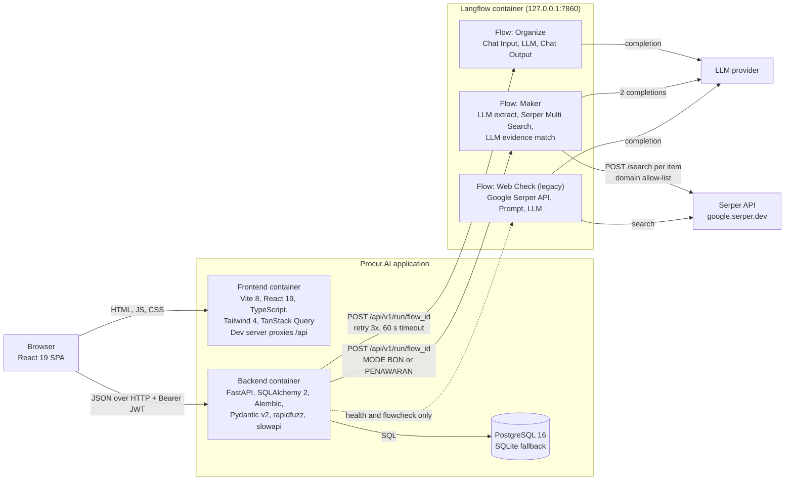
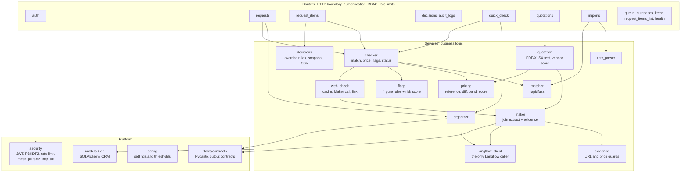
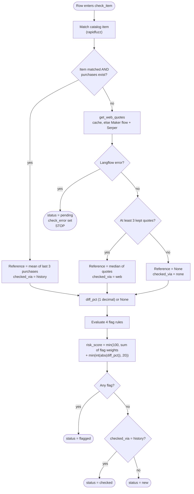
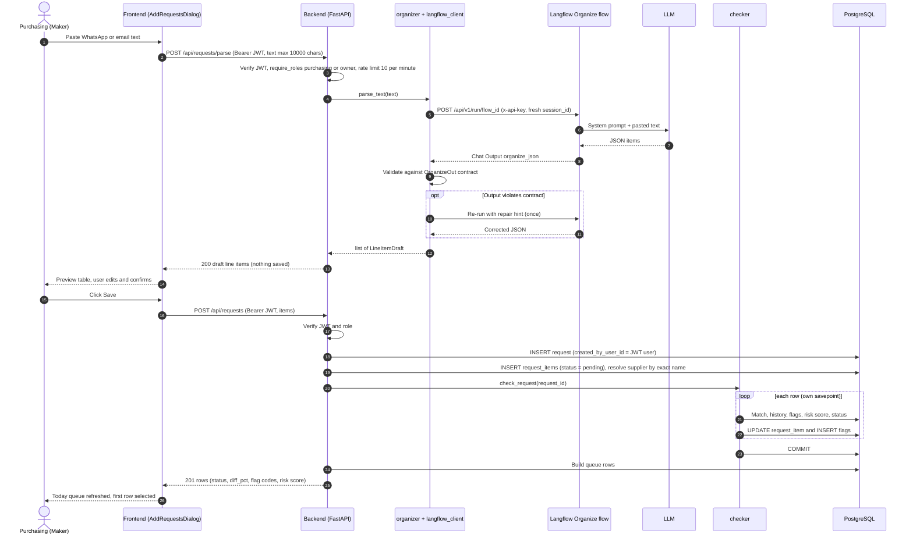
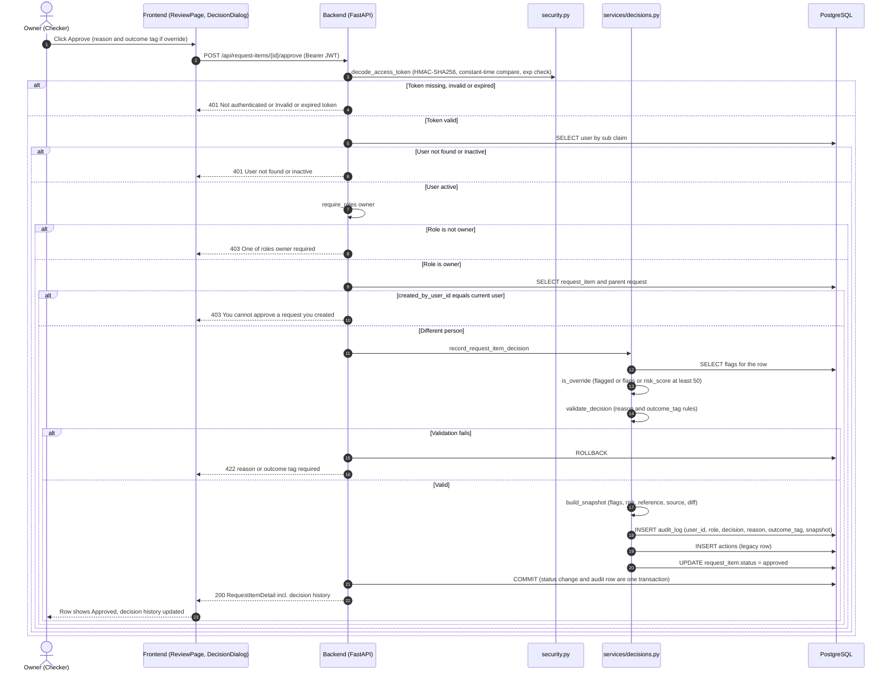
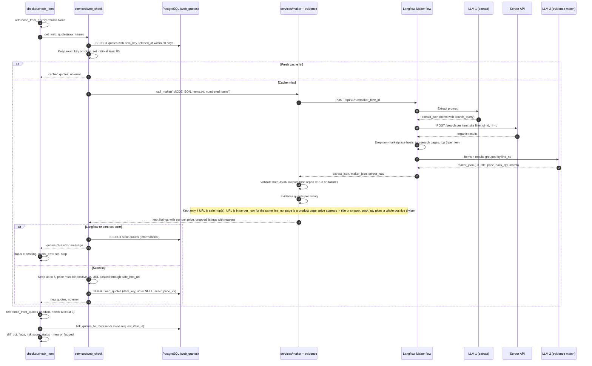
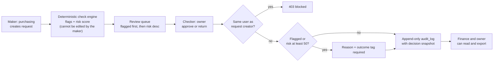

# Procur.AI — Architecture & Audit Documentation

> **Document type:** Architecture description (C4 Context and Container views, Arc42 building-block view, UML sequence diagrams).
> **Scope:** the `PROCUR_2` repository as of commit `a81bc47` (branch `security`).
> **Method:** every statement below was extracted from the source (`backend/app/routers/`, `backend/app/services/`, `backend/app/models.py`, `langflow/*.json`, `backend/eval/`). Where the code and the older prose docs (`AGENTS.md`, `README.md`, `SECURITY_PROGRESS.md`, `KNOWN_ISSUES.md`) disagree, **the code is treated as the source of truth** and the difference is listed in [Section 9](#9-known-gaps-and-documentation-drift).
> **Setup and demo script:** see [`README.md`](README.md). This file does not repeat installation steps.

## Table of contents

1. [Executive summary](#1-executive-summary)
2. [System architecture (C4 context and container)](#2-system-architecture-c4-model)
3. [Folder structure](#3-folder-structure)
4. [Role-based access control matrix](#4-role-based-access-control-rbac-matrix)
5. [Input condition and business-logic matrix](#5-input-condition--business-logic-matrix-truth-table)
6. [Sequence diagrams](#6-sequence-diagrams-uml)
7. [Security and compliance](#7-security--compliance-sector-1)
8. [QA and AI evaluation](#8-qa--ai-evaluation-sector-3)
9. [Known gaps and documentation drift](#9-known-gaps-and-documentation-drift)

---

## 1. Executive summary

**Procur.AI** (also referred to as *Tilas.AI* in the project history) is a procurement price-check and approval web application. A purchasing officer pastes the day's informal purchase requests (a WhatsApp message, an email, or a vendor quotation PDF/XLSX). The system turns the free text into structured line items, benchmarks every line against the company's own purchase history (or, for unknown items, against live Indonesian marketplace prices), raises explainable risk flags, and routes the result to an independent approver. Every approval or return is written to an append-only decision log.

### Problem: procurement leakage and internal fraud

Medium-sized manufacturers typically buy daily from many small suppliers, negotiate over chat, and keep purchase records in spreadsheets or nowhere. That produces four recurring loss patterns, each of which maps to a detection rule in the code:

| Loss pattern | Detection rule (code) |
|---|---|
| Paying above the going rate (overpricing, kickbacks) | `PRICE_ABOVE_REF` — quoted price more than 15 % above the reference |
| Buying stock that is already on the shelf | `STOCK_COVER_HIGH` — stock covers more than 1 month of use |
| Inflated or split quantities | `QTY_UNUSUAL` — quantity above 2× the historical median |
| Orders steered to an unvetted or fictitious supplier | `NEW_SUPPLIER` — named supplier has no purchase history |
| A single person requesting *and* approving | Maker-Checker separation, enforced in `request_items._decide` |

### Target users

Medium enterprises **without an ERP**. Procur.AI does not ask them to adopt one: the purchase history is seeded from an Excel/CSV import, and the demo-grade stack (FastAPI, PostgreSQL or SQLite, local Langflow) runs on a single machine.

| Role (DB value) | Maker-Checker position | Typical person |
|---|---|---|
| `purchasing` | **Maker** — raises and checks requests | Purchasing officer |
| `owner` | **Checker** — approves or returns | Owner or plant manager |
| `finance` | **Viewer** — read-only oversight and audit | Finance or accounting staff |

### Design principle

> **The model handles language; the backend handles numbers.**

LLMs (through Langflow) only read messy text and find marketplace listings. Every price, percentage, flag, band, recommendation, vendor score and risk score is computed in deterministic Python (`pricing.py`, `flags.py`, `evidence.py`). The model's output is treated as untrusted input and is validated against Pydantic contracts and evidence guards before it can influence a number. Money is always an integer rupiah (`BIGINT` / `int`), and "today" is always Asia/Jakarta.

---

## 2. System architecture (C4 model)

### 2.1 Level 1 — System context



### 2.2 Level 2 — Containers



**Container responsibilities**

| Container | Technology | Responsibility | Trust boundary notes |
|---|---|---|---|
| Frontend | React 19, Vite 8, TypeScript 6, Tailwind 4, TanStack Query 5 | Role-aware navigation (`lib/roles.ts`), forms, inspector, formatting (`Intl.NumberFormat('id-ID')`). **Never calls Langflow or an LLM.** | The UI only *hides* controls; the backend enforces every rule. |
| Backend | Python 3.11+, FastAPI 0.143, SQLAlchemy 2.1, Pydantic 2.14 | Authentication, RBAC, check engine, pricing and flag rules, decision log, the only Langflow client (`services/langflow_client.py`). | Treats all Langflow output as untrusted; validates with `flows/contracts.py` and `services/evidence.py`. |
| Database | PostgreSQL 16 (Docker, bound to `127.0.0.1`) or SQLite via `DATABASE_URL` | System of record: catalog, purchases, stock, requests, flags, web-quote cache, users, `audit_log`, quotations. | Money columns are `BIGINT`. |
| Langflow | Langflow 1.12.x run locally with `uv`, bound to `127.0.0.1` | Hosts three exported flows (`langflow/*.json`). Secrets are loaded from Langflow global variables, never stored in the JSON (`scripts/check_langflow_secrets.py`). | Reachable only from the backend with an API key. |
| Serper API | `https://google.serper.dev/search` | Google results for marketplace-restricted queries (`site:tokopedia.com OR site:shopee.co.id OR site:blibli.com OR site:lazada.co.id`, `gl=id`, `hl=id`). | Results from any other host are dropped inside the Langflow component. |

**Langflow flows (extracted from the exported JSON)**

| Flow file | Nodes | Used by the backend? | Output names |
|---|---|---|---|
| `langflow/Organize.json` | Chat Input → Language Model → Chat Output | **Yes** — `services/organizer.py` (Add Request parse, Quick Check) | `organize_json` |
| `langflow/Maker.json` | Chat Input + extract Prompt → **LLM #1** (extract) → **Serper Multi Search** (custom component) → evidence Prompt → **LLM #2** (match listings) | **Yes** — `services/maker.py`, used by `web_check.py` (`MODE: BON`) and `quotation.py` (`MODE: PENAWARAN`) | `extract_json`, `maker_json`, `serper_raw` |
| `langflow/Web Check.json` | Chat Input → Google Serper API → Type Convert → Prompt → Language Model → Chat Output | **No** for pricing. Replaced by `Maker.json` in milestone M18. Still listed in `FLOW_ID_SETTINGS`, `flowcheck` and `/api/health/flows`. | `webcheck_json` |
| *(checker_agent, risk_narrator)* | Contracts exist in `flows/contracts.py` (`CheckerOut`, `NarratorOut`); **no exported flow yet**. | No | `checker_json`, `narrator_json` |

> **Model provider (as exported):** `Maker.json` selects `Anthropic: claude-haiku-5-5`; `Organize.json` and `Web Check.json` select `OpenAI Compatible: langflow` (a local gateway). Source: `backend/eval/results.md`, run on 2026-10-31. `README.md` states Claude Haiku for all flows; the exports show otherwise.

### 2.3 Arc42 building-block view (backend, level 2)



---

## 3. Folder structure

Excluded: `.git/`, `.venv/`, `node_modules/`, `__pycache__/`, `dist/`, `.pytest_cache/`. Secrets files (`.env`, `backend/.env`) exist locally and are git-ignored.

```text
PROCUR_2/
├── README.md                        # Setup, features, demo script, release steps (read by scripts/check_claims.py)
├── ARCHITECTURE.md                  # This document
├── AGENTS.md                        # Coding-agent rules: non-negotiables, stack, key paths
├── AUDIT.md                         # Earlier code/security audit findings (C1, H1, H2, M1...)
├── KNOWN_ISSUES.md                  # Bug and handover list (Indonesian)
├── SECURITY_PROGRESS.md             # Phase 0/1 security hardening log (Indonesian; partly outdated, see §9)
├── TECHNICAL_ROADMAP.md             # Roadmap derived from mentor feedback
├── PROGRESS_REPORT_20261024.md      # Dated progress report
├── PROGRESS_REPORT_20261030.md      # Dated progress report
├── DEMO_VIDEO_PLAN.md               # Storyboard for the demo video
├── docker-compose.yml               # PostgreSQL 16, published on 127.0.0.1:5432 only
├── start.sh / stop.sh               # Start and stop backend, frontend and Langflow in separate process groups
├── .env.example                     # Template for root-level environment variables
├── .bob/rules-{ask,plan,agent}/     # Mode-specific agent rule files
│
├── backend/
│   ├── requirements.txt             # Pinned Python dependencies
│   ├── alembic.ini                  # Alembic configuration
│   ├── .env.example                 # Template: DATABASE_URL, JWT_SECRET, LANGFLOW_*, DEMO_PASSWORD
│   ├── .coveragerc                  # Line coverage over app/services
│   ├── sample_data/                 # purchases_sample.csv / .xlsx for the Excel import demo
│   ├── alembic/versions/            # 9 migrations: initial schema → users/audit → risk_score →
│   │                                #   created_by_user_id → web_quote item_key → excel source →
│   │                                #   quotations → decision-log columns
│   │
│   ├── app/
│   │   ├── main.py                  # FastAPI app: lifespan validation, CORS, TrustedHost, security headers, router wiring
│   │   ├── config.py                # Pydantic Settings: APP_NAME, secrets, flow IDs, ALL thresholds; validate_settings()
│   │   ├── db.py                    # SQLAlchemy engine, SessionLocal, get_db dependency
│   │   ├── models.py                # ORM: Supplier, Item, Purchase, Stock, Request, RequestItem, WebQuote,
│   │   │                            #   Flag, Action, User, AuditLog (append-only guard), Quotation, QuotationLine
│   │   ├── schemas.py               # Pydantic request/response models (QueueRow, RequestItemDetail, DecisionOut...)
│   │   ├── security.py              # PBKDF2 hashing, HS256 JWT, slowapi limiter, mask_pii, safe_http_url (SSRF guard)
│   │   ├── seed.py                  # Deterministic demo data + 3 demo users; production/remote-DB reset guard
│   │   ├── flowcheck.py             # CLI: runs langflow/fixtures through each flow and validates against contracts
│   │   │
│   │   ├── flows/
│   │   │   └── contracts.py         # Pydantic contracts per flow output, repair-retry JSON parser, FlowContractError
│   │   │
│   │   ├── routers/                 # HTTP layer; every router has router-level get_current_user
│   │   │   ├── auth.py              # POST /api/auth/login; get_current_user, require_roles, require_role
│   │   │   ├── requests.py          # POST /api/requests/parse (Organize flow), POST /api/requests (save + check)
│   │   │   ├── request_items.py     # GET detail (PII-masked supplier), recheck, approve, return, self-approval guard
│   │   │   ├── request_items_list.py# GET /api/request-items: paginated history by date/status
│   │   │   ├── queue.py             # GET /api/queue: "Today" rows by Jakarta date, counts per status
│   │   │   ├── decisions.py         # GET /api/decisions(.csv), GET /api/review (owner review queue)
│   │   │   ├── audit_logs.py        # GET /api/audit-logs: legacy audit view (owner, finance)
│   │   │   ├── quick_check.py       # POST /api/quick-check: dry-run check, writes no request rows
│   │   │   ├── quotations.py        # Upload vendor PDF/XLSX, list, detail, to-queue
│   │   │   ├── imports.py           # POST /api/imports/purchases (.xlsx/.csv), template download
│   │   │   ├── purchases.py         # GET /api/purchases, /api/purchases/item/{id}, /api/suppliers
│   │   │   ├── items.py             # GET /api/items/{id}/suppliers: per-supplier last price
│   │   │   └── health.py            # GET /api/health/flows (owner): Langflow reachability + last flowcheck
│   │   │
│   │   └── services/                # Business logic; no FastAPI imports
│   │       ├── checker.py           # CORE ENGINE: match → reference → diff → flags → risk → status (check_item, dry_check_item)
│   │       ├── pricing.py           # Reference price (history mean of last 3, web median of ≥3), diff_pct, band, recommend, vendor_score
│   │       ├── flags.py             # Four pure flag rules + FLAG_RISK_WEIGHT + calculate_risk_score
│   │       ├── matcher.py           # Name normalization (unit synonyms) + rapidfuzz match against catalog and aliases
│   │       ├── web_check.py         # Web-quote cache (fuzzy key, max age), Maker call, quote persistence and linking
│   │       ├── maker.py             # Calls Maker flow, validates both JSON outputs (one repair retry), joins by line_no
│   │       ├── evidence.py          # Evidence guards: URL in serper_raw, product page, price in snippet, pack_qty per-unit price
│   │       ├── organizer.py         # Calls Organize flow, parses LineItemDraft list (one repair retry)
│   │       ├── langflow_client.py   # ONLY module that talks to Langflow: run_flow (3 attempts), pick_output, ping
│   │       ├── decisions.py         # Override rule, decision validation, snapshot, record_request_item_decision, safe CSV
│   │       ├── quotation.py         # PDF/XLSX text extraction (pdfplumber/openpyxl), per-line band, vendor score
│   │       └── xlsx_parser.py       # Header-alias (EN/ID) .xlsx purchase-history parser with per-row errors
│   │
│   ├── eval/                        # AI evaluation harness (formerly backend/qa; see §8)
│   │   ├── run.py                   # Runner: stamps git commit, model IDs and flow sha256; writes results.json/.md
│   │   ├── common.py                # Throwaway SQLite DB, offline web cache, SuiteSkipped, data loaders
│   │   ├── e1.py                    # Organize extraction accuracy per field + E1b flag propagation
│   │   ├── e2.py                    # Flag detection and false-positive rate (offline)
│   │   ├── e3.py                    # Web-price MAPE, no-quote rate, off-by->30 % rate (live: Langflow + Serper)
│   │   ├── e4.py                    # Catalog name-matching wrong-match rate (offline)
│   │   ├── e5.py, e6.py             # Placeholders for checker_agent and payment-detection suites
│   │   ├── data/                    # Ground truth: e1/*.txt + ground_truth.json, e2_rows.json, e3_prices.csv, e4_names.csv
│   │   ├── results.json / results.md# Last run output (2026-10-31, commit 2018f1b)
│   │
│   └── tests/                       # 28 pytest modules, in-process SQLite; no Langflow or PostgreSQL needed
│       ├── conftest.py              # Fixtures: test DB, users per role, auth headers
│       ├── test_pricing.py, test_flags.py, test_matcher.py, test_check_engine.py   # Deterministic engine
│       ├── test_auth.py, test_security.py, test_middleware.py, test_rate_limit.py  # AuthN/Z and hardening
│       ├── test_decisions.py        # Override rules, append-only log (AuditLogImmutableError), decision CSV
│       │                            #   (self-approval 403 and role 403s are in test_auth.py)
│       ├── test_evidence.py, test_contracts.py, test_langflow*.py, test_flowcheck.py  # Flow boundary
│       ├── test_quick_check.py, test_quotations.py, test_web_price_path.py          # Features
│       ├── test_import*.py, test_purchases.py, test_api.py, test_seed_guard.py     # Data layer and API
│       ├── test_config_validation.py, test_health_flows.py, test_eval.py           # Config and harness
│       └── test_live_flows.py       # Real-Langflow tests, skipped unless `pytest -m live`
│
├── frontend/
│   ├── package.json                 # React 19, Vite 8, Tailwind 4, TanStack Query 5, oxlint
│   ├── vite.config.ts               # Dev server; proxies /api to the backend
│   ├── index.html                   # SPA entry
│   └── src/
│       ├── main.tsx / App.tsx       # Bootstraps React Query; token check → Landing / Login / role-aware app shell
│       ├── index.css                # Tailwind entry and design tokens
│       ├── types/api.ts             # TypeScript mirrors of backend schemas
│       ├── lib/
│       │   ├── api.ts               # fetch wrapper: attaches Bearer token; on 401 clears session and returns to login
│       │   ├── roles.ts             # Role → visible tabs, landing page, canAddRequests, canRecheck
│       │   ├── decisions.ts         # Approve/return dialog rules mirrored from the backend
│       │   └── format.ts            # Rupiah (id-ID), signed percent, Jakarta dates
│       ├── hooks/                   # TanStack Query hooks: useQueue, useReview, useRequestItem, useItemActions,
│       │                            #   useRequestHistory, usePurchases, useQuotation, useSuppliers, useHash...
│       └── components/
│           ├── LandingPage, LoginPage        # Public entry and JWT login form
│           ├── AppHeader                     # Role-filtered navigation and "Add requests" button
│           ├── QueueHeader, QueueTable, FilterChips, StatusChip, BandChip, SkeletonRow  # "Today" screen
│           ├── Inspector, WebQuotesTable, SupplierPanel, ItemPurchasePanel, DecisionHistory  # Row detail
│           ├── ReviewPage, DecisionDialog    # Owner's approve/return workflow
│           ├── AddRequestsDialog             # Paste → Organize preview → save
│           ├── QuickCheckPage                # Dry-run checker (purchasing)
│           ├── VendorQuotesPage              # Quotation upload and vendor score (purchasing)
│           ├── ImportPage                    # Excel/CSV purchase-history import (purchasing)
│           ├── HistoryPage, HistoryTable, RequestsTab, PurchasesTab  # Past requests and purchases
│           └── AuditLogPage                  # Decision log (owner, finance)
│
├── langflow/
│   ├── Organize.json                # Flow 1: text → line items (LLM only)
│   ├── Maker.json                   # maker_agent: extract → Serper Multi Search → evidence match
│   ├── Web Check.json               # Legacy web-check flow (superseded by Maker, kept for health checks)
│   ├── maker_agent_prompts.md       # Contract between Maker.json and the backend; recommended flow edits
│   └── fixtures/{organize,maker,web_check}/  # 01_clean, 02_messy, 03_injection inputs for flowcheck
│
├── scripts/
│   ├── release_check.ps1            # pytest+coverage, frontend build, secrets check, flowcheck, claims check
│   ├── check_langflow_secrets.py    # Fails if any flow export contains a key or a non-global-variable api_key
│   └── check_claims.py              # Fails if README's "<N> tests" / coverage claims drift from reality
│
├── design/                          # Approved UI references: reference.html, quick-check.html
└── plans/                           # Build plans: Phase 1 (M1–M15), Phase 2 (M16–M26), per-screen plans
```

---

## 4. Role-based access control (RBAC) matrix

Authorization is enforced **server-side** by FastAPI dependencies in `routers/auth.py`:

- `get_current_user` — validates the Bearer JWT, then reloads the user from the database and rejects inactive accounts (401).
- `require_roles(*roles)` — wraps the above and returns **403** when `user.role` is not in the set.

Every router also declares `dependencies=[Depends(get_current_user)]` at router level, so **no route is anonymous** except `POST /api/auth/login` and the unauthenticated `GET /api/health` liveness probe in `main.py`.

### 4.1 Feature matrix (requested features)

Legend: ✅ allowed · ❌ denied (403) · ◐ conditional

| Feature | API endpoint(s) | `purchasing` (Maker) | `owner` (Checker) | `finance` (Viewer) | Enforcement |
|---|---|:---:|:---:|:---:|---|
| **Add Requests** (parse + save) | `POST /api/requests/parse`, `POST /api/requests` | ✅ | ✅ | ❌ | `require_roles("purchasing","owner")` |
| **View Today** (queue + inspector) | `GET /api/queue`, `GET /api/request-items/{id}` | ✅ | ✅ | ✅ | any authenticated user |
| **Quick Check** (dry run) | `POST /api/quick-check` | ✅ | ❌ | ❌ | `require_roles("purchasing")` |
| **Approve / Return** | `POST /api/request-items/{id}/approve`, `/return` | ❌ | ◐ (never on own request) | ❌ | `require_roles("owner")` + self-approval guard |
| **View Audit Log** | `GET /api/audit-logs`, `GET /api/decisions`, `GET /api/decisions.csv` | ❌ | ✅ | ✅ | `require_roles("owner","finance")` |
| **Import Excel/CSV** | `POST /api/imports/purchases` | ✅ | ❌ | ❌ | `require_roles("purchasing")` |

### 4.2 Additional capabilities found in the code

| Capability | API endpoint | `purchasing` | `owner` | `finance` | Notes |
|---|---|:---:|:---:|:---:|---|
| Owner review queue (flagged first, by risk score) | `GET /api/review` | ❌ | ✅ | ❌ | `require_roles("owner")` |
| Re-run the check on a row | `POST /api/request-items/{id}/recheck` | ◐ own requests only | ✅ any row | ❌ | Ownership checked per row in the handler; rate-limited 10/min |
| Upload vendor quotation (PDF/XLSX) | `POST /api/quotations` | ✅ | ❌ | ❌ | Max 10 MB, magic-byte check, rate-limited 10/min |
| Queue a checked quotation | `POST /api/quotations/{id}/to-queue` | ◐ uploader only | ❌ | ❌ | 403 for other users, 409 if already queued |
| History (past requests, purchases, suppliers) | `GET /api/request-items`, `/api/purchases`, `/api/suppliers`, `/api/items/{id}/suppliers` | ✅ | ✅ | ✅ | any authenticated user |
| List or open quotations | `GET /api/quotations`, `/{id}` | ✅ | ✅ | ✅ | Any authenticated user at API level; the UI shows the tab to `purchasing` only |
| Flow health | `GET /api/health/flows` | ❌ | ✅ | ❌ | `require_roles("owner")` |

### 4.3 UI navigation (`frontend/src/lib/roles.ts`)

| Role | Visible tabs | Landing page |
|---|---|---|
| `purchasing` | Today, Quick check, Vendor quotes, History, Import | `#today` |
| `owner` | Review, Today, History, Audit Log | `#review` |
| `finance` | Today, History, Audit Log | `#history` |

`canOpenHash()` redirects a user who types a URL hash they may not open. This is **cosmetic**; the same rules are re-enforced by the API, so a hand-crafted request still gets a 403.

### 4.4 Design notes

- **`owner` may also add requests.** The backend (`_ENTRY_ROLES = ("purchasing", "owner")`) and `canAddRequests()` both allow it. Because an owner can therefore be the *maker* of a request, the self-approval guard (§7.3) is what keeps Maker-Checker meaningful.
- **`finance` is strictly read-only** over the decision log and queue. A "Payments" page is planned (comment in `roles.ts`) but not implemented.
- Roles are stored as free text in `users.role` (default `purchasing`). There is no role table; the three valid values are the only ones the dependencies and the frontend recognize.

---

## 5. Input condition & business-logic matrix (truth table)

Source: `services/checker.py` (`_do_check`, `dry_check_item`), `services/flags.py`, `services/pricing.py`, `services/matcher.py`, `services/web_check.py`, `config.py`.

### 5.1 What the three input conditions mean in code

| Input | Concrete test in the engine |
|---|---|
| **Has History** | `match_item(raw_name)` finds a catalog item (`token_set_ratio ≥ 85` **and** `token_sort_ratio ≥ 70` against the name or an alias) **and** that item has at least one row in `purchases`. `reference_from_history` then returns the **mean of the last 3 purchase prices**, rounded to whole rupiah. |
| **Has Supplier** | `quoting_supplier_name` is non-empty. The supplier counts as *known* only if its name equals a `suppliers.name` exactly (`==`, case-sensitive, resolved in the router) **and** it has at least one purchase. |
| **Has Price** | `quoted_unit_price_idr` is not null. `diff_pct = round((quoted − ref) / ref × 100, 1)` is `None` if either side is missing or `ref == 0`. |

**The web check is triggered by one condition only: no history reference** (`ref_price is None` after the history step). Whether a price or supplier was supplied does not influence it.

### 5.2 Decision pipeline



Rows already `approved` or `returned` keep their status; the checker never overwrites a human decision.

### 5.3 Case matrix

| Aspect | **Case A** — History ✅, Supplier ✅, Price ✅ | **Case B** — History ❌, Supplier ✅, Price ✅ | **Case C** — History ❌, Supplier ❌, Price ❌ |
|---|---|---|---|
| **Web check triggered?** | **No.** History wins; neither the cache nor Langflow/Serper is touched. | **Yes.** `_fetch_cached` (≤ 60 days, fuzzy key ≥ 85) → on miss, Maker flow `MODE: BON` → Serper. | **Yes**, for the same reason (no history). Runs even though there is nothing to compare it with. |
| **Reference price** | Mean of last 3 purchases (`checked_via = history`, `history_count` = 1–3) | Median of ≥ 3 guard-approved web quotes (`checked_via = web`). With fewer than 3: `None` (`checked_via = none`). | Same as B; informational only because there is no quoted price. |
| **`diff_pct`** | Computed | Computed if a reference exists, else `None` | Always `None` |
| **`PRICE_ABOVE_REF`** (> 15 %) | Fires if diff > 15 (message: "3-buy average") | Fires if reference exists and diff > 15 (message: "web median") | Cannot fire |
| **`STOCK_COVER_HIGH`** (cover > 1 month) | Evaluated when the item has a `stock` row | Only if a catalog item matched *and* has stock (e.g. matched item with no purchases); otherwise skipped | Skipped (no catalog item) |
| **`QTY_UNUSUAL`** (> 2× median past qty) | Evaluated when `qty` is given (history provides past quantities) | Skipped: it needs past purchases, which are absent by definition | Skipped |
| **`NEW_SUPPLIER`** | Fires only if the named supplier is unknown or has no purchases | Fires if the supplier is unknown or has no purchases. This is the *common* outcome for a never-bought item. | Cannot fire (no supplier named) |
| **Possible statuses** | `checked` (no flags) or `flagged` | `flagged` (≥ 1 flag) or `new` (no flags). **Never `checked`.** `pending` if Langflow failed. | `new` (never flagged), or `pending` on Langflow failure |
| **Risk score** | `Σ weights + min(int(\|diff\|), 20)`, capped at 100 | Same formula; web-based rows without a price flag get 0–20 from the diff alone | **0** (no flags, no diff) |
| **Approval rule** | Approving a `flagged` row or one with `risk_score ≥ 50` is an *override*: reason and outcome tag are mandatory. | Same. | No override needed, because the row is `new` with score 0. |

### 5.4 Risk score calculation (`flags.calculate_risk_score`)

| Component | Points |
|---|---:|
| `PRICE_ABOVE_REF` | 30 |
| `STOCK_COVER_HIGH` | 20 |
| `QTY_UNUSUAL` | 15 |
| `NEW_SUPPLIER` | 10 |
| `min(int(abs(diff_pct)), 20)` (always applied when `diff_pct` exists) | 0–20 |
| **Total** | `min(Σ, 100)` — theoretical maximum 95 before the cap |

Worked examples (computed from the formula above):

| Scenario | Flags | Calculation | Score | Status |
|---|---|---|---:|---|
| A, clean: quoted +3.0 % vs 3-buy average | none | 0 + min(3, 20) | **3** | `checked` |
| A, flagged: +29.5 %, stock already covers ~6 weeks | `PRICE_ABOVE_REF`, `STOCK_COVER_HIGH` | 30 + 20 + min(29, 20) | **70** | `flagged` (override required) |
| B, new supplier, +20 % over web median | `PRICE_ABOVE_REF`, `NEW_SUPPLIER` | 30 + 10 + 20 | **60** | `flagged` (override required) |
| B, only 2 web quotes found, supplier known | none | reference `None`, diff `None` | **0** | `new` |
| C, free-text item, nothing else known | none | 0 | **0** | `new` |

> **Note on `diff_pct` sign:** the diff term uses the *absolute* value, so a price 25 % **below** reference adds 20 points even though no `PRICE_ABOVE_REF` fires. This looks deliberate (an unusually cheap quote is also suspicious) but it is not explained in the code. The behaviour is now pinned by `TestCalculateRiskScore` in `backend/tests/test_flags.py` (including the worked examples above).

### 5.5 Failure behaviour

| Failure | Result |
|---|---|
| Any unexpected exception in a row's check | Savepoint rolled back; `status = pending`, `check_error = "Pengecekan gagal, coba lagi nanti."`; full traceback logged server-side only. Other rows in the request are unaffected. |
| Langflow/Serper failure on the web path | Row saved as `pending` with `check_error`; stale cached quotes are **not** used to compute a reference. |
| Langflow output breaks its contract | Whole flow re-run once with a repair hint; a second failure raises `FlowContractError` → row/quotation stays `pending`, or HTTP 502 on the parse endpoints. |

### 5.6 Price bands and recommendations (vendor quotations and inspector)

| `diff_pct` | Band | Recommendation |
|---|---|---|
| ≤ −10 | `KOMPETITIF` | `SETUJU` |
| ≤ +5 | `WAJAR` | `SETUJU` |
| ≤ +15 | `PERHATIAN` | `NEGOSIASI` |
| > +15 and ≤ +30 | `TIDAK WAJAR` | `NEGOSIASI` |
| > +30 | `TIDAK WAJAR` | `TOLAK` |
| no reference | `UNKNOWN` | none |

Vendor score = `round(0.8 × value-weighted band points + 20 if arithmetic_ok)`, where band points are 100/85/50/0 and `arithmetic_ok` requires every `qty × unit_price` to match `line_total` (and the lines to sum to the quote total) within Rp 1.

---

## 6. Sequence diagrams (UML)

### 6.1 Flow 1 — Maker: add a request



### 6.2 Flow 2 — Checker: approve a request



### 6.3 Flow 3 — Web check (Serper API)

In the current code the web check runs through the **Maker flow** in `MODE: BON` (see §2.2). The sequence below follows `web_check.get_web_quotes` → `maker.call_maker`.



---

## 7. Security & compliance (Sector 1)

### 7.1 Authentication (JWT)

Implemented in `backend/app/security.py` and `backend/app/routers/auth.py` using the **standard library only** (no third-party JWT package).

| Control | Implementation |
|---|---|
| Password storage | PBKDF2-HMAC-SHA256, **600 000 iterations**, 16-byte random salt per user, format `pbkdf2_sha256$600000$<salt>$<hash>`. Legacy single-salt hashes are **rejected**, not upgraded. |
| Password comparison | `hmac.compare_digest` (constant time). |
| Token | HS256: `{sub: user_id, role, exp}`; **1-hour** lifetime; signature verified with `hmac.compare_digest`; `exp` and non-empty `sub` required. |
| Secret handling | `JWT_SECRET` is mandatory and must be ≥ 32 characters; `validate_settings()` exits the process at startup otherwise. `DATABASE_URL` is also mandatory (no default credentials). |
| Per-request revalidation | The user is reloaded from the DB on every request; a deactivated user (`is_active = false`) is rejected immediately even with a valid token. The **role is taken from the database, not the token claim**, so a role change takes effect at once. |
| Login protection | `5/minute` per IP (slowapi). Same error message for unknown user, wrong password and inactive user (no user enumeration). |
| Client storage | Token, role and username are kept in `localStorage`. On any 401 the client clears the session and returns to the login screen. |

Defense in depth on the HTTP surface (`main.py`):

| Layer | Setting |
|---|---|
| `TrustedHostMiddleware` | Only `ALLOWED_HOSTS` (default `localhost,127.0.0.1`); other `Host` headers get 400 |
| CORS | Allow-list of the Vite dev origins only |
| Response headers | `Content-Security-Policy`, `X-Content-Type-Options: nosniff`, `X-Frame-Options: DENY`, `Referrer-Policy: no-referrer` |
| Rate limiting (`RATE_LLM = 10/minute` per IP) | `/api/requests/parse`, `/api/quick-check`, `/api/request-items/{id}/recheck`, `/api/quotations` |
| Input limits | Parse text ≤ 10 000 chars; quick-check ≤ 5 000; import ≤ 5 MB / quotation ≤ 10 MB; `.xlsx`/`.pdf` **magic-byte** validation |
| Network binding | PostgreSQL published on `127.0.0.1` only; `start.sh` binds Langflow, backend and Vite to localhost |
| Seed safety | `seed --reset` refuses when `APP_ENV=production` or the DB host is not local, unless `--i-know-what-i-am-doing` |

### 7.2 PII masking and untrusted-data controls

**`mask_pii` (`security.py`)** replaces every word of four or more characters by its first letter plus asterisks (`CV Sinar Pelumas` → `CV S**** P******`).

- It is applied to `quoting_supplier_name` in the **request-item detail response** (`GET /api/request-items/{id}`). The stored value is **not** modified.
- It is a pattern mask, not a PII detector: it masks *all* long tokens (including product words and digits) and is currently wired to that one field. Supplier names shown by the history and supplier panels come from the `suppliers` table unmasked.

**Controls on data that originates from an LLM or the web** (the real "untrusted input" boundary of this system):

| Threat | Control | Location |
|---|---|---|
| Model hallucinates a URL or price | A listing is kept only if its URL appears in the Serper results for the **same `line_no`**, and its price is written in that result's title/snippet. Everything else is dropped with a reason code (`bad_url`, `url_not_in_search`, `search_page`, `no_price`, `price_not_in_result`, `bad_pack_qty`). | `services/evidence.py` |
| Model does arithmetic wrongly | The model never computes: `pack_qty` is a divisor supplied by the model and **Python divides**, rounding half-up to whole rupiah. | `evidence.per_unit_price` |
| Malformed model JSON | Pydantic contracts; one automatic repair retry; then `FlowContractError`. Money fields must be integers; fractional rupiah fails the contract. | `flows/contracts.py` |
| Prompt injection inside a document or request | Python is the defence: injected text can change only extracted strings, never a band, score, flag or approval. Fixtures `03_injection.txt` exercise this in `flowcheck`. | `langflow/fixtures/*` |
| SSRF / malicious links | `safe_http_url` accepts only `http`/`https` with a hostname, ≤ 2048 chars; blocks loopback, private and link-local IPs and `localhost`. Invalid URLs are stored as `NULL` (price kept) and the UI renders them as text. | `security.safe_http_url`, `web_check._save_quotes` |
| Off-marketplace results | The Serper component keeps only `tokopedia.com`, `shopee.co.id`, `blibli.com`, `lazada.co.id` hosts. | `langflow/Maker.json` (SerperMultiSearch) |
| CSV/Excel formula injection in exports | Cells starting `= + - @ TAB CR` are prefixed with `'`. | `decisions._csv_safe` |
| Information leakage | `check_error` holds a generic message; tracebacks go to server logs only. | `checker.check_item` |
| Secrets in flow exports | Pre-commit script rejects key patterns and any non-empty `api_key` that is not a Langflow global variable. | `scripts/check_langflow_secrets.py` |

### 7.3 Audit trail

All approve/return decisions go through **one function**, `decisions.record_request_item_decision`, which writes a row to `audit_log`:

| Column | Content |
|---|---|
| `user_id`, `role` | Who decided, and in which role *at that moment* |
| `subject_type`, `subject_id` | `request_item` today; schema also admits `quotation` and `bundle` |
| `decision`, `reason`, `outcome_tag` | `approve`/`return`; free-text reason; `false_alarm` or `risk_accepted` on overrides |
| `snapshot` (JSON) | **What the decider saw:** status, flags (code + message), risk score, quoted and reference prices, reference source (`history`/`web`/`none`), history count, `diff_pct` |
| `created_at` | Server timestamp; exported in Asia/Jakarta |

**Immutability.** A SQLAlchemy `before_flush` listener raises `AuditLogImmutableError` on any update or delete of an `AuditLog` object, and no HTTP route updates or deletes the log. This protects against application-level tampering. It is an **ORM-level guard**: a database administrator with direct SQL access can still alter rows (no trigger or revoked privilege exists yet).

**Override discipline.** Approving a row that is `flagged`, carries any flag, or has `risk_score ≥ 50` (`OVERRIDE_RISK_SCORE`) requires **both** a reason and an outcome tag. Returning always requires a reason. Violations return 422 and nothing is written.

**Read paths.** `GET /api/decisions` (filters by Jakarta date range and subject type), `GET /api/decisions.csv` (UTF-8 BOM, formula-safe) and the legacy `GET /api/audit-logs`, all limited to `owner` and `finance`.

**Scope note:** the log records *decisions*. Request creation is attributed through `requests.created_by_user_id`; logins and imports are not written to `audit_log`.

### 7.4 How Maker-Checker prevents internal fraud



| Fraud scenario | Control that stops or exposes it |
|---|---|
| Buyer approves their own inflated purchase | `purchasing` cannot call approve/return (403). If an `owner` created the request, `_decide` rejects approve **and** return on it (403). |
| Approver quietly waves through a suspicious row | Override requires a reason and an outcome tag, and a snapshot of the evidence is stored with the decision. Finance can audit "who approved a flagged row, why, and what they saw". |
| Buyer edits the evidence to look clean | The reference price, flags and risk score are computed server-side from history and web quotes. The maker supplies only the quoted price, quantity and supplier, which are exactly the values being tested. |
| Decision rewritten after the fact | `audit_log` is append-only at the ORM level; the snapshot freezes the numbers as they were. |
| Shared or stolen credentials | Per-user accounts; role read from DB per request; 1-hour tokens; deactivation takes effect immediately; login rate-limited. |
| Fictitious supplier | `NEW_SUPPLIER` flag (+10 risk, forces override if combined with other signals). |

**Residual limits (stated openly):** the guard compares *user IDs*, so it cannot detect two colluding accounts; requests with no recorded creator (seed or legacy rows) have no self-approval check; and tokens cannot be revoked before expiry other than by deactivating the user.

---

## 8. QA & AI evaluation (Sector 3)

> **Where is `qa/`?** The original `backend/qa/` (`eval_llm.py`, `eval_serper.py`) was moved and generalized into **`backend/eval/`** in commit `a81bc47`. There is no top-level `qa/` folder; this section documents `backend/eval/` and `backend/tests/`.

### 8.1 Framework layout

| Layer | Tool | What it proves | Needs Langflow? |
|---|---|---|---|
| Unit and integration tests | `pytest` (28 modules in `backend/tests/`; `README.md` states 506 tests collected, enforced by `scripts/check_claims.py`; last full run 505 passed, 1 skipped) | Deterministic engine: pricing, flags, matcher, decisions, RBAC, evidence guards, contracts, rate limits, imports | No (SQLite in-process, Langflow mocked) |
| Coverage | `pytest --cov` (`.coveragerc`, source `app/services`) | 95.6 % line coverage over `app/services` at the last run (README states 96 %, the rounded value `check_claims.py` compares) | No |
| Live flow check | `python -m app.flowcheck` | Every fixture in `langflow/fixtures/<flow>/` (clean, messy, **injection**) passes through the real flow and satisfies its contract; result visible at `GET /api/health/flows` | Yes |
| **AI evaluation harness** | `python -m eval.run --suite E1,E2,E3,E4` | Accuracy of the AI-dependent parts against hand-labelled ground truth | E1, E3 yes; E2, E4 offline |
| Release gate | `scripts/release_check.ps1` | pytest + coverage + frontend build + secret scan + flowcheck + claims check, stopping at first failure | Yes (flowcheck) |

### 8.2 The evaluation suites

| Suite | Question | Method | Data |
|---|---|---|---|
| **E1** | Does Organize extract the right fields? | Each `.txt` message → `organizer.parse_text` → paired to ground-truth rows by name similarity → per-field exact comparison (unit/department after synonym mapping; price exact in whole rupiah; `None` means "must not be invented") | `eval/data/e1/` — 3 real messages, 5 ground-truth rows |
| **E1b** | Do extraction mistakes change the flags? | Same rows (parsed vs ground truth) run through `dry_check_item` offline; count flags gained or lost | same |
| **E2** | Do the four flags fire when they should? | 8 hand-labelled rows → checker on a throwaway seeded DB → detection rate and false-positive rate per flag | `e2_rows.json` (**example data**) |
| **E3** | Are web reference prices close to reality? | Item → Maker flow `MODE: BON` exactly as `web_check` sends it → evidence guards → `reference_from_quotes` → compare with a manually checked price | `e3_prices.csv` (item names only, **no manual prices yet**) |
| **E4** | Does catalog matching pick the wrong item? | Request names vs catalog; wrong-match and missed-match rates | `e4_names.csv` (**example data**) |
| E5, E6 | Checker extraction and payment detection | placeholders | land with M21–M22 |

Every run is stamped with the Asia/Jakarta time, git commit, the model in each exported flow and the **sha256 of every `langflow/*.json`**, so each number traces to the exact flow that produced it. Suites run on a throwaway SQLite file and never touch the dev database; a suite lacking data, a flow ID or a reachable Langflow is reported as **skipped with the reason**, never silently passed. Data files marked as example are labelled *"EXAMPLE DATA — not a measurement"* in the output.

### 8.3 Metric definitions

**MAPE — Mean Absolute Percentage Error (Web Check, suite E3)**

```
APE(item)  = | reference_i − manual_i | / manual_i × 100
MAPE       = (1 / n) × Σ APE(item)      over items that obtained a web reference
```

- `reference_i` is `pricing.reference_from_quotes()`: the **median** of guard-approved quotes, only when at least `WEB_MIN_QUOTES = 3` remain.
- `manual_i` is a hand-read marketplace price recorded with date and URL.
- Reported next to it (so MAPE is not flattering by omission): *no quotes %*, *no reference (< 3 quotes) %*, *off by more than 30 % (share of scored)* and *listings dropped by the evidence guards*.

**Field-level accuracy (LLM extraction, suite E1)**

```
accuracy(field) = rows where field is correct / ground-truth rows        (missed rows count as wrong)
```

Fields: `item`, `qty`, `unit`, `price`, `supplier`, `department`. The `item` name counts as correct at ≥ 0.8 string similarity to the ground-truth name or one of its `name_accept` variants. Also reported: rows missed, rows invented.

### 8.4 Measured results (last run: 2026-10-31T22:00:55+07:00, commit `2018f1b`)

The task brief asked to *assume* high accuracy. That assumption is **not** applied here, because the harness has already produced numbers and they are not uniformly high. These are the recorded values, from `backend/eval/results.md`.

**E1 — Organize extraction (3 messages, 5 ground-truth rows)**

| Field | Correct / Rows | Accuracy |
|---|---:|---:|
| `item` (name) | 1 / 5 | **20.0 %** |
| `qty` | 5 / 5 | 100.0 % |
| `unit` | 5 / 5 | 100.0 % |
| `price` | 5 / 5 | 100.0 % |
| `supplier` | 5 / 5 | 100.0 % |
| `department` | 5 / 5 | 100.0 % |
| Rows missed / invented | 0 / 0 | — |

- **Why `item` is low (inference from the run's mismatch log):** the model returned English names (`oli` → "Lubricating oil", `lakban bening 2 inch` → "Clear packing tape 2 inch", `sarung tangan katun` → "Cotton gloves"), although the Organize prompt says *keep names in Indonesian*. Numbers, units, suppliers and departments were all read correctly. The exported `Organize.json` selects `OpenAI Compatible: langflow`, not Claude, which may explain the non-compliance. An earlier script (`backend/qa/eval_llm.py`, commit `6be9dc2`) reported "100 %" under *semantic* matching; the current harness is stricter and string-based.
- **E1b:** 1 of 5 rows changed its flags because of misreading: `lakban bening 2 inch` gained a `QTY_UNUSUAL` flag when parsed as "Clear packing tape 2 inch". 0 flags lost, 4 ground-truth flags. (Why the translated name changes the catalog match was not investigated.)
- **Caveat:** n = 5 rows. The target in `eval/data/README.md` is 30 messages.

**E2 — Flag detection** — *example data, not a measurement.* 8 rows, 5 planted anomalies: detection 100 % and false positives 0 % for all four flags. This only demonstrates that the harness works.

**E4 — Name matching** — *example data, not a measurement.* 8 names: wrong-match rate 12.5 % (1 false match: `bearing` → `Bearing 6205 ZZ`, the known "short name matches too much" weakness listed in `KNOWN_ISSUES.md` §3.4).

**E3 — Web Check MAPE: not yet measured.** Status **skipped**: `e3_prices.csv` lists 10 item names but none has the required manual price, date and URL. There is therefore **no MAPE value to report**, and none is invented here.

### 8.5 Acceptance targets and how to produce the missing numbers

These are **targets to be verified, not results**:

| Metric | Proposed target | How to produce a real value |
|---|---|---|
| Web Check MAPE | ≤ 15 % with *off by > 30 %* ≤ 10 % | Fill 15 rows of `eval/data/e3_prices.csv` (`manual_price_idr`, `checked_on`, `source_url`), start Langflow with `LANGFLOW_MAKER_FLOW_ID` and a Serper key, run `python -m eval.run --suite E3` |
| Extraction field accuracy | ≥ 95 % per field on ≥ 30 messages | Grow `eval/data/e1/` to 30 messages; add `name_accept` variants if English names are acceptable, or fix the flow's model/prompt so Indonesian names are kept |
| Flag detection | ≥ 95 % detection, ≤ 5 % false positives | Replace `e2_rows.json` with about 100 labelled rows |
| Name matching | ≤ 5 % wrong-match | Replace `e4_names.csv` with 40 names |

---

## 9. Known gaps and documentation drift

Found while reading the code against the repo's prose documents. None were changed by this audit.

| # | Observation | Evidence | Suggested action |
|---|---|---|---|
| 1 | Web-quote cache lifetime is **60 days** in code; `AGENTS.md` says **7 days**. | `config.WEB_QUOTE_MAX_AGE_DAYS = 60` | Align the rule or the setting |
| 2 | `Web Check.json` is **no longer used** for pricing. Pricing runs through `Maker.json` + Serper. (`README.md` setup was corrected on 2 Nov; `AGENTS.md` and `.bob/` rules still mention DuckDuckGo.) | `web_check.py` calls `call_maker`; `contracts.py`: "replaced by maker_agent in M18" | Keep or remove the legacy flow; see `DOCS_AUDIT.md` §2 |
| 3 | `SECURITY_PROGRESS.md` and `KNOWN_ISSUES.md` list **SEC-01 (no authentication)** and **CSP** as open; both are implemented (JWT + RBAC from M16, CSP in `main.py`). | `routers/auth.py`, `main.py` | Refresh both documents |
| 4 | `mask_pii` is wired to a single field. | `grep mask_pii` | Apply to other supplier-name outputs if masking is a requirement |
| 5 | `audit_log` immutability is enforced in the ORM only. | `models._audit_log_append_only` | Add a PostgreSQL trigger or revoke `UPDATE/DELETE` for the app role |
| 6 | JWT is kept in `localStorage` and cannot be revoked before expiry. | `frontend/src/lib/api.ts`, `security.py` | Consider HttpOnly cookies and a token denylist before any real deployment |
| 7 | `checker_agent` and `risk_narrator` flows have contracts, settings and health checks but **no exported flow or service**. | `flows/contracts.py`, `config.py` | Treat as planned (M21–M24) |
| 8 | Exported flows use different model providers (Maker: Anthropic; Organize/Web Check: OpenAI-compatible gateway). | `eval/results.md` | Re-export after standardizing on the intended model |
| 9 | Several internal messages are in Indonesian (`check_error`, drop-reason labels, startup logs) while API detail strings are English. | `checker.py`, `evidence.py`, `config.py` | Decide on one language per audience |
| 10 | Dev-only CORS, CSP `connect-src` and `TrustedHost` values point at `localhost:5173`. | `main.py` | Make them configurable before deployment |
| 11 | ~~Missing tests in `flags.py` / `pricing.py`~~ **Fixed 2 Nov:** `TestCalculateRiskScore` and `TestReferenceFromHistory` added; the dead `pricing.reference_from_web` was deleted (it had no caller). | `backend/tests/test_flags.py`, `test_pricing.py` | Done |
| 12 | ~~`Maker.json` lacked the `extract_json` Chat Output~~ **Fixed 2 Nov in the committed file:** `ChatOutput-2FAR2` wired from Language Model #1. A flow already imported into Langflow must be re-imported, or the output added by hand (`langflow/maker_agent_prompts.md`). The edit was made to the JSON directly and was **not opened in a live Langflow**. | `backend/tests/test_langflow_exports.py` | Re-import, then run `python -m app.flowcheck` |
| 13 | Organize item-name accuracy is 20% (E1, 5 rows): the model translates Indonesian names to English. | `backend/eval/results.md` | See [`DOCS_AUDIT.md` §1](DOCS_AUDIT.md#1-priority-finding-organize-item-name-accuracy-is-20) |

*Verified:* on 2 Nov 2026 a fresh `backend/.venv` ran the full suite: 505 passed, 1 skipped (live-Langflow test), 506 collected, 95.6 % coverage over `app/services` (figures after the 2 Nov test additions; the first run that day gave 487 passed / 488 collected / 95.1 %). *Not verified:* runtime behaviour of Langflow and Serper (neither was available), and the eval numbers, which are the recorded 31 Oct values.

Stale-document register and the 20 % finding: [`DOCS_AUDIT.md`](DOCS_AUDIT.md).
